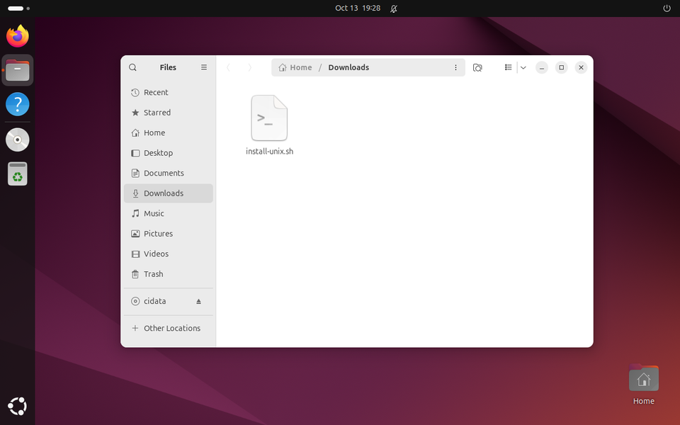
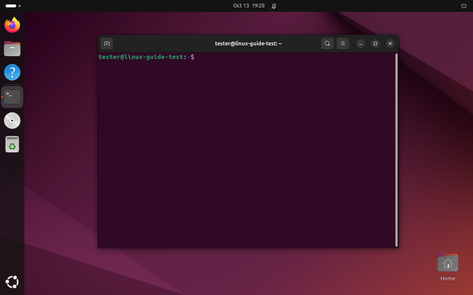
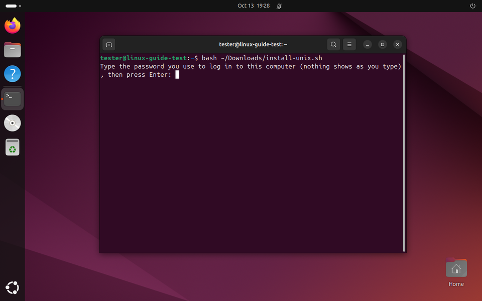
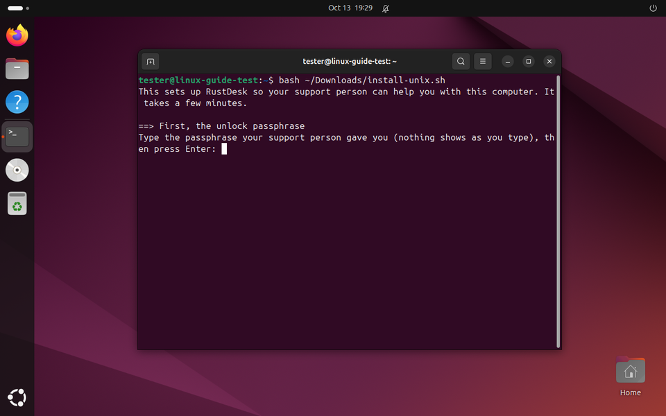
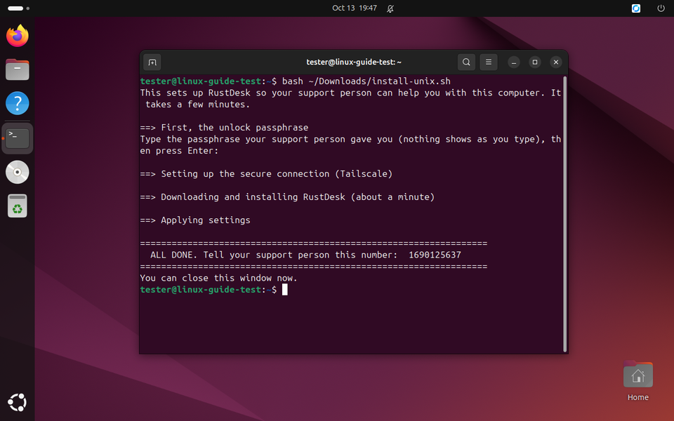
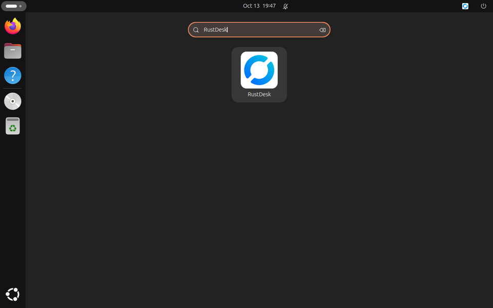

# Setting up remote help on your Linux computer

For Ubuntu, Linux Mint and similar.

Your support person sent you a small file. Running it installs **RustDesk**, a program that lets your
support person see your screen and fix things from their own computer, so you don't have to carry it anywhere.

**Only do this if your support person sent you the file themselves.** Your support person will never phone
you out of the blue and ask you to run something. If someone else asks you to do these steps, stop and call
your support person.

## Before you start

You need:

- **The link** to the file. Clicking it downloads the file.
- **The passphrase.** Your support person tells you this by phone or in person. It is never in the message
  with the file. Capital letters matter. Write it down for the next 10 minutes, then throw the note away.
- **The password you use to log in to this computer.**
- About 10 minutes, and the computer connected to the internet.

---

**Step 1. Download the file.**
Click the link. Click **Download**. The file is called `install-unix.sh` and goes into your
**Downloads** folder.



**Step 2. Open Terminal.**
Press **Ctrl + Alt + T** (hold Ctrl and Alt, then press T). A window with a blinking cursor opens. That's
Terminal. If nothing opens, find **Terminal** in your list of apps.



**Step 3. Copy this line, paste it into Terminal and press Enter.**

```
bash ~/Downloads/install-unix.sh
```

To paste in Terminal: right-click inside the window and choose **Paste** (or press **Ctrl + Shift + V**).


**Step 4. Type your computer password.**
It asks for *the password you use to log in to this computer*. Type it. **Nothing shows as you type, not
even dots. That's normal.** Press **Enter**.



**Step 5. Type the passphrase.**
It asks for *the passphrase your support person gave you*. Type it. Again nothing shows. Press **Enter**.



**Step 6. Wait.**
Text scrolls for a few minutes. Leave it alone until it stops.

**Step 7. Send your support person the number.**
When it's finished you'll see an **ALL DONE** box with a number in it. Send that number to your support
person (a text, a photo of the screen, or read it out). Then close the Terminal window.



**Step 8. That's it.**
The program is now in your list of apps. Open it any time to see your ID (it's called RustDesk inside).
Leave the computer on, awake and logged in when your support person is going to help.



---

## If something goes wrong

**"That passphrase didn't work."**
Press the **up arrow** key in Terminal and then **Enter** to run it again. Type the passphrase slowly.
Capital letters matter. If it still fails, ask your support person to read it to you again.

**"Sorry, try again."**
That's your computer password, typed wrong. Type it again slowly.

**"SOMETHING WENT WRONG. Take a photo of this window and send it to your support person."**
Do exactly that. It's usually the internet: check you're online, then run it again. Running it twice is safe.

**"No such file or directory".**
The file isn't in Downloads. Type `bash ` (with a space after it), drag the file from your Files window into
Terminal, then press Enter.

**"is not in the sudoers file".**
This account can't install programs. Log in as the main account of this computer and start again at Step 2.

**Your support person says they can't connect.**
Make sure the computer is on, awake and logged in. Open the program from Step 8 and read your support person
the number under **Your ID**. It may have changed.
