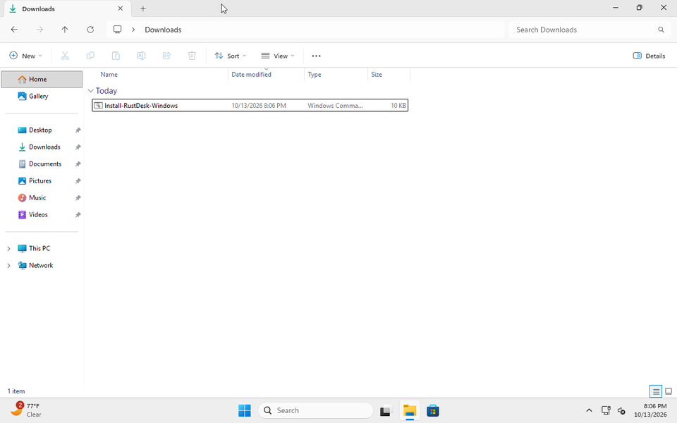
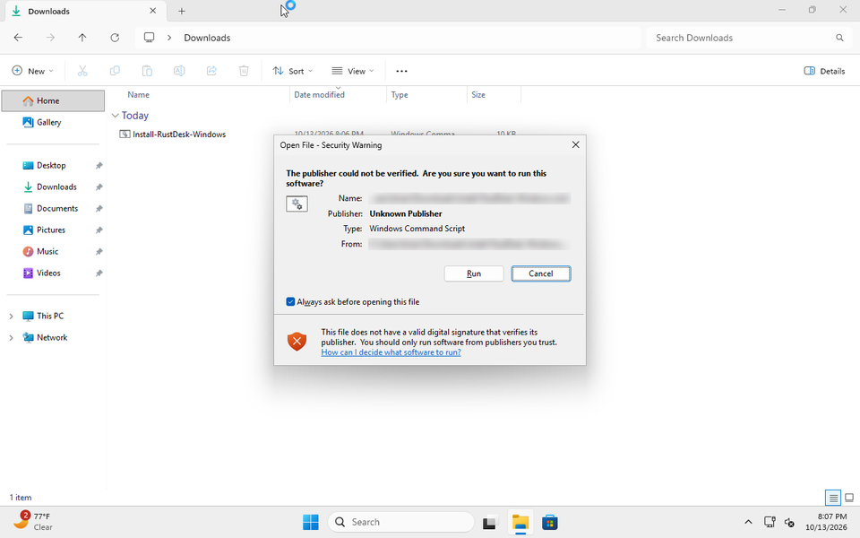
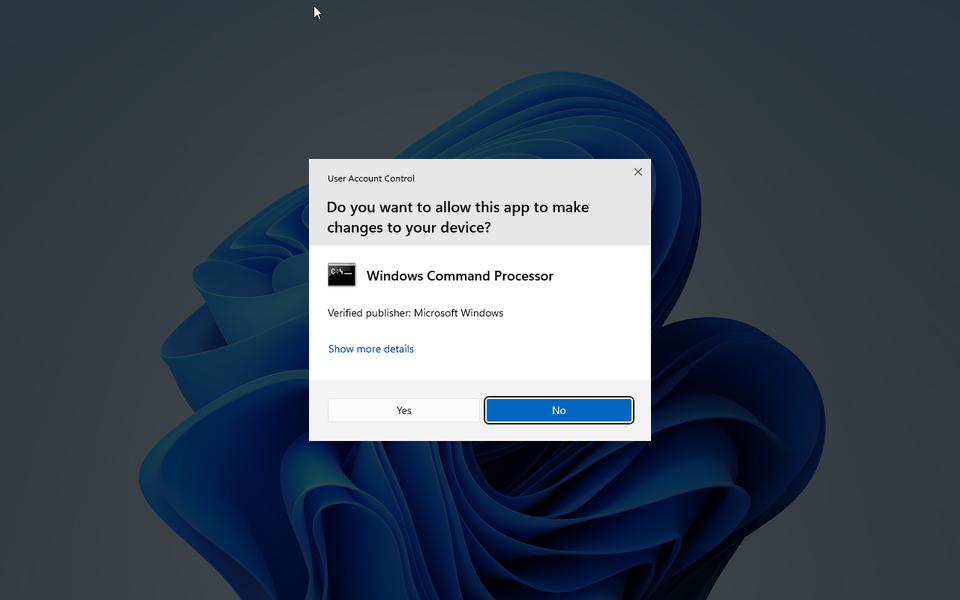
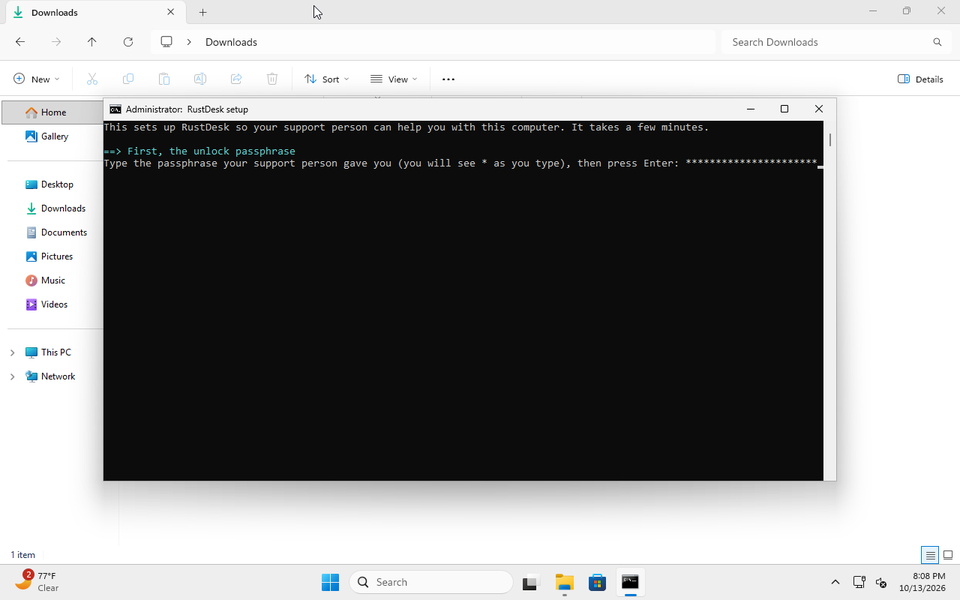
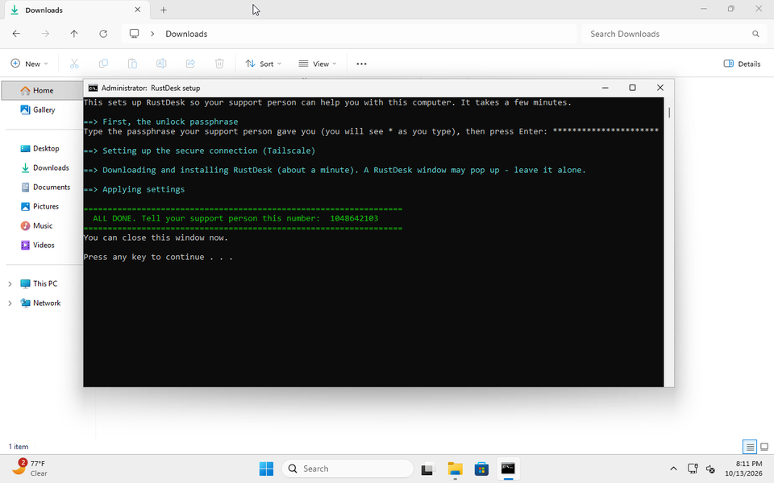
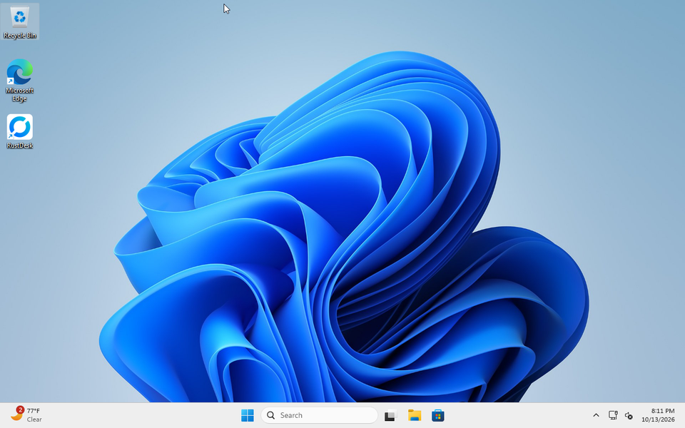
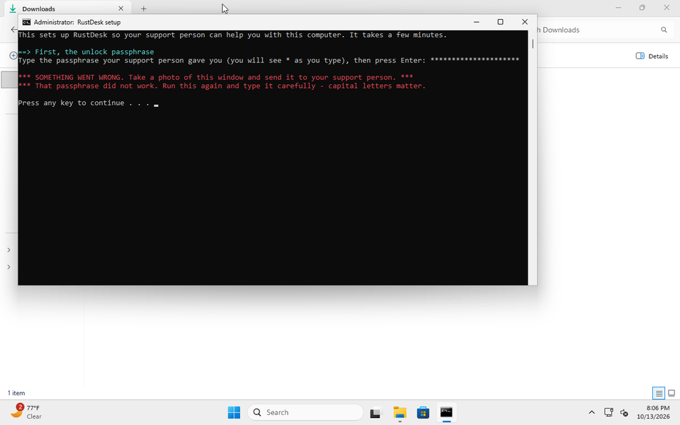

# Setting up remote help on your Windows computer

Your support person sent you a small file. Running it installs **RustDesk**, a program that lets your
support person see your screen and fix things from their own computer, so you don't have to carry it anywhere.

**Only do this if your support person sent you the file themselves.** Your support person will never phone
you out of the blue and ask you to run something. If someone else asks you to do these steps, stop and call
your support person.

## Before you start

You need:

- **The link** to the file. Clicking it downloads the file.
- **The passphrase.** Your support person tells you this by phone or in person. It is never in the message
  with the file. Capital letters matter. Write it down for the next 10 minutes, then throw the note away.
- About 10 minutes, and the computer connected to the internet.

---

**Step 1. Download the file.**
Click the link. Click **Download**. The file is called `Install-RustDesk-Windows.cmd`.
If the browser says *"This file isn't commonly downloaded"* or *"might be harmful"*: find the little
**⋯** or **^** next to the download, click it, click **Keep**. If it asks again, click **Show more**, then
**Keep anyway**.

**Step 2. Open your Downloads folder and double-click the file.**
Open **File Explorer** (the yellow folder on the taskbar). Click **Downloads** on the left.
Double-click **Install-RustDesk-Windows**.

**Step 3. Windows checks the file. Click Run.**
A box says *"The publisher could not be verified"*. Click **Run**.
(Some computers show a blue box instead, saying *"Windows protected your PC"*. Click **More info**, then
**Run anyway**.)

**Step 4. Click Yes.**
A box asks *"Do you want to allow this app to make changes to your device?"* Click **Yes**.
(If it asks for a password here, it's the password of the main person who uses this computer.)

**Step 5. Type the passphrase.**
A black window asks for the passphrase. Type it. You'll see `*` instead of letters. That's normal.
Press **Enter**.

**Step 6. Wait.**
Text appears for 2 to 5 minutes. A **RustDesk** window may pop open on its own. Leave it alone.
If a **Tailscale** window pops up, close it with the **X**. Don't click anything in it.

**Step 7. Send your support person the number.**
When it's finished you'll see a green **ALL DONE** box with a number in it.
Send that number to your support person (a text, a photo of the screen, or read it out).
Then press any key to close the window.

**Step 8. That's it.**
There's now an icon on your desktop. Double-click it any time to open the program (it's called RustDesk
inside). Leave the computer on and awake when your support person is going to help.

---

## If something goes wrong

**Red text: "That passphrase did not work".**
You typed the passphrase wrong. Press any key to close, double-click the file again, and type it slowly.
Capital letters matter. If it still fails, ask your support person to read it to you again.

**Red text: "SOMETHING WENT WRONG" (anything else).**
Take a photo of the whole window and send it to your support person. It's usually the internet: check
you're online, then run the file again. Running it twice is safe.

**I clicked No, or the black window vanished, or nothing happened.**
Double-click the file again and click **Yes** on the "allow this app" box.

**A window full of code opened (Notepad).**
You opened the wrong file. The right one is `Install-RustDesk-Windows.cmd`.

**The file disappeared from Downloads.**
Your antivirus removed it. Tell your support person; they'll send it another way.

**Your support person says they can't connect.**
Make sure the computer is on and not asleep. Double-click the icon from Step 8 and read your support
person the number under **Your ID**. It may have changed.
